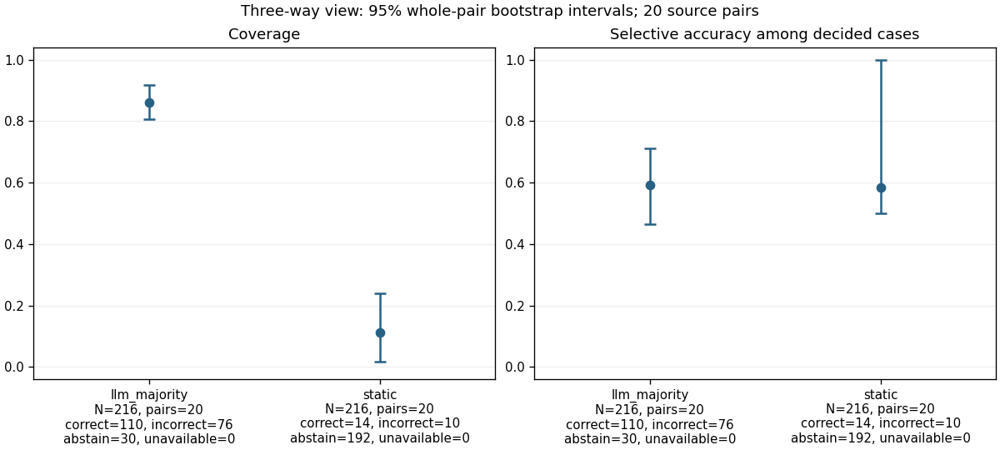
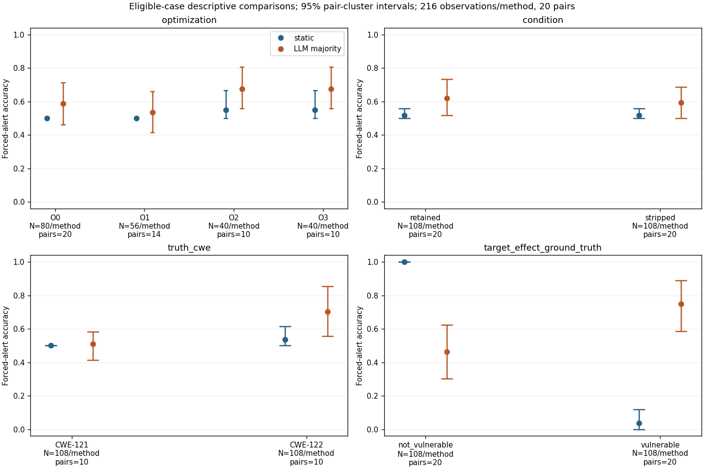
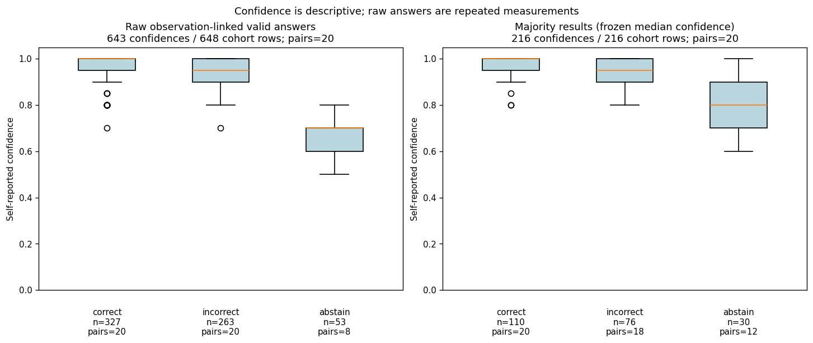

# Phase H quantitative analysis: final-v1

The analysis uses 216 eligible observations per method (432 condition rows), 648 observation-linked LLM repetitions, 528 actual requests and 20 source-program pairs. The 104 proven-eliminated observations are never scored. All six Phase G tables were regenerated from frozen evidence and matched byte for byte.

## Definitions and pre-analysis amendments

- **three_way**: Correct: vulnerable with exact CWE on vulnerable truth, or not_vulnerable on fixed truth. Other decided calls incorrect; uncertain abstains; failed response unavailable.
- **coverage**: (correct + incorrect) / N; abstention_rate = abstain / N; selective_accuracy = correct / (correct + incorrect). Always report these with counts.
- **forced_alert**: vulnerable alerts; not_vulnerable, uncertain and unavailable do not. Failed-run nullable binary_correct is never reused; the operational policy is applied explicitly.
- **primary_Correct**: 1 for a correct decided classification ignoring CWE, 0 for incorrect, abstaining or unavailable outcomes. Fixed-case abstention scores 0.
- **sensitivity_Correct_forced**: 1 when forced alert/no-alert matches truth, including fixed-case abstention/failure; 0 otherwise.
- **forced_metrics**: accuracy=(TP+TN)/N; balanced_accuracy=(TP/(TP+FN)+TN/(TN+FP))/2; precision=TP/(TP+FP); recall=TP/(TP+FN); F1=2TP/(2TP+FP+FN); FPR=FP/(FP+TN); FNR=FN/(FN+TP).
- **intervals**: 95% percentile whole-pair bootstrap, 10000 replicates, seed 20261014, shared weights across strata and paired method differences. Undefined denominators are null; intervals not estimable if >5% replicates undefined.
- **agreement**: All-three-valid identical / all records or observations. Pairwise agreement pools equal classification pairs / valid repetition pairs; missing comparisons excluded and denominators shown.
- **confidence**: Raw correctness/confidence is observation weighted. Majority confidence is frozen median over ALL valid repetitions, not only winning votes. High confidence >=0.8; explicit negative calls define high-confidence FN, with abstentions listed separately.
- **sampling**: 20 source-program pairs are the clusters. 528 distinct requests expand to 648 observation-linked rows; 216 observations per method. 104 eliminated observations are excluded entirely.

Original preregistration (committed): `7856cce`. Pre-analysis amendments documented before aggregate metrics were computed. The amendments are committed with the implementation and results, not as part of the original preregistration.

- Replace custom Python GLMM with R/lme4 maximum likelihood, nAGQ=30; fixed BOBYQA and scaled-gradient diagnostics.
- Remove Firth fitting; fallback is full GLMM, main-effects GLMM, then descriptive pair-cluster intervals with no model of record.

Post-analysis reporting corrections:

- Post-analysis reporting correction: distinct-request status summaries are overall only; factor subgroups use observation-weighted rows because a request can span factor levels. Overall request counts, performance estimates, intervals and model selection are unchanged.

F3 uses the preserved campaign server-log slice. Its refreshed receipt and Phase G manifest bind the same frozen prediction tables. Input, plan, code, environment and artifact hashes are in `analysis.json`.

## Three-way view

Intervals in brackets are approximate 95% whole-pair percentile bootstrap intervals.

| Method / view | N | Pairs | Correct | Incorrect | Abstain | Unavailable | Coverage | Abstention rate | Selective accuracy |
| --- | --- | --- | --- | --- | --- | --- | --- | --- | --- |
| llm_majority / condition | 216 | 20 | 110 | 76 | 30 | 0 | 86.1% [80.8%, 91.8%] | 13.9% [8.2%, 19.2%] | 59.1% [46.5%, 71.1%] |
| static / condition | 216 | 20 | 14 | 10 | 192 | 0 | 11.1% [1.8%, 24.0%] | 88.9% [76.0%, 98.2%] | 58.3% [50.0%, 100.0%] |
| llm_run / raw_observation_weighted | 648 | 20 | 327 | 263 | 53 | 5 | 91.0% [86.2%, 96.0%] | 8.2% [2.9%, 13.2%] | 55.4% [47.1%, 63.1%] |

Selective accuracy is conditional on deciding. It must be read with coverage and abstention counts.

## Forced binary-alert view

Abstentions and failures raise no alert under the explicit operational policy; they are not confident safe decisions.

| Method / view | N | Pairs | TP | TN | FP | FN | TN abstain | FN abstain | TN failure | FN failure |
| --- | --- | --- | --- | --- | --- | --- | --- | --- | --- | --- |
| llm_majority / condition | 216 | 20 | 81 | 50 | 58 | 27 | 14 | 16 | 0 | 0 |
| static / condition | 216 | 20 | 4 | 108 | 0 | 104 | 98 | 94 | 0 | 0 |
| llm_run / raw_observation_weighted | 648 | 20 | 254 | 141 | 183 | 70 | 29 | 24 | 2 | 3 |

| Method | N | Pairs | Accuracy | Balanced accuracy | Precision | Recall | F1 | FPR | FNR |
| --- | --- | --- | --- | --- | --- | --- | --- | --- | --- |
| llm_majority | 216 | 20 | 60.6% [51.6%, 70.5%] | 60.6% [51.6%, 70.5%] | 58.3% [51.2%, 66.7%] | 75.0% [58.7%, 88.8%] | 65.6% [56.0%, 74.2%] | 53.7% [37.7%, 69.6%] | 25.0% [11.2%, 41.3%] |
| static | 216 | 20 | 51.9% [50.0%, 55.9%] | 51.9% [50.0%, 55.9%] | 100.0% [not estimable] | 3.7% [0.0%, 11.8%] | 7.1% [0.0%, 21.1%] | 0.0% [0.0%, 0.0%] | 96.3% [88.2%, 100.0%] |
| llm_run | 648 | 20 | 61.0% [54.7%, 67.6%] | 61.0% [54.7%, 67.6%] | 58.1% [53.7%, 63.1%] | 78.4% [63.7%, 90.5%] | 66.8% [59.3%, 73.1%] | 56.5% [45.8%, 67.9%] | 21.6% [9.5%, 36.3%] |

## Experimental factors

These are unadjusted eligible-case comparisons. Eliminated variants change subgroup composition; optimization comparisons are not causal effects. The CSV tables include all counts, rates, intervals and usable bootstrap counts, including optimization × symbol strata and raw repetitions.

### optimization

| Method | Level | N | Pairs | Correct | Incorrect | Abstain | Unavailable | Coverage | Selective accuracy | Forced accuracy | Balanced accuracy |
| --- | --- | --- | --- | --- | --- | --- | --- | --- | --- | --- | --- |
| llm_majority | O0 | 80 | 20 | 41 | 25 | 14 | 0 | 82.5% [72.5%, 91.2%] | 62.1% [50.0%, 75.0%] | 58.8% [46.2%, 71.2%] | 58.8% [46.2%, 71.2%] |
| llm_majority | O1 | 56 | 14 | 23 | 21 | 12 | 0 | 78.6% [63.5%, 90.9%] | 52.3% [37.1%, 66.7%] | 53.6% [41.7%, 65.9%] | 53.6% [41.7%, 65.9%] |
| llm_majority | O2 | 40 | 10 | 23 | 15 | 2 | 0 | 95.0% [87.5%, 100.0%] | 60.5% [42.3%, 78.0%] | 67.5% [55.8%, 80.8%] | 67.5% [55.8%, 80.8%] |
| llm_majority | O3 | 40 | 10 | 23 | 15 | 2 | 0 | 95.0% [87.5%, 100.0%] | 60.5% [42.3%, 78.0%] | 67.5% [55.8%, 80.8%] | 67.5% [55.8%, 80.8%] |
| static | O0 | 80 | 20 | 0 | 0 | 80 | 0 | 0.0% [0.0%, 0.0%] | NA | 50.0% [50.0%, 50.0%] | 50.0% [50.0%, 50.0%] |
| static | O1 | 56 | 14 | 6 | 6 | 44 | 0 | 21.4% [0.0%, 45.5%] | 50.0% [50.0%, 50.0%] | 50.0% [50.0%, 50.0%] | 50.0% [50.0%, 50.0%] |
| static | O2 | 40 | 10 | 4 | 2 | 34 | 0 | 15.0% [0.0%, 38.9%] | 66.7% [not estimable] | 55.0% [50.0%, 66.7%] | 55.0% [50.0%, 66.7%] |
| static | O3 | 40 | 10 | 4 | 2 | 34 | 0 | 15.0% [0.0%, 38.9%] | 66.7% [not estimable] | 55.0% [50.0%, 66.7%] | 55.0% [50.0%, 66.7%] |

### condition

| Method | Level | N | Pairs | Correct | Incorrect | Abstain | Unavailable | Coverage | Selective accuracy | Forced accuracy | Balanced accuracy |
| --- | --- | --- | --- | --- | --- | --- | --- | --- | --- | --- | --- |
| llm_majority | retained | 108 | 20 | 56 | 39 | 13 | 0 | 88.0% [81.8%, 94.2%] | 58.9% [44.7%, 72.4%] | 62.0% [51.7%, 73.4%] | 62.0% [51.7%, 73.4%] |
| llm_majority | stripped | 108 | 20 | 54 | 37 | 17 | 0 | 84.3% [76.7%, 91.7%] | 59.3% [47.1%, 71.0%] | 59.3% [50.0%, 68.8%] | 59.3% [50.0%, 68.8%] |
| static | retained | 108 | 20 | 7 | 5 | 96 | 0 | 11.1% [1.8%, 24.0%] | 58.3% [50.0%, 100.0%] | 51.9% [50.0%, 55.9%] | 51.9% [50.0%, 55.9%] |
| static | stripped | 108 | 20 | 7 | 5 | 96 | 0 | 11.1% [1.8%, 24.0%] | 58.3% [50.0%, 100.0%] | 51.9% [50.0%, 55.9%] | 51.9% [50.0%, 55.9%] |

### truth_cwe

| Method | Level | N | Pairs | Correct | Incorrect | Abstain | Unavailable | Coverage | Selective accuracy | Forced accuracy | Balanced accuracy |
| --- | --- | --- | --- | --- | --- | --- | --- | --- | --- | --- | --- |
| llm_majority | CWE-121 | 108 | 10 | 45 | 41 | 22 | 0 | 79.6% [73.3%, 87.5%] | 52.3% [43.7%, 59.4%] | 50.9% [41.4%, 58.3%] | 50.9% [41.4%, 58.3%] |
| llm_majority | CWE-122 | 108 | 10 | 65 | 35 | 8 | 0 | 92.6% [87.5%, 97.6%] | 65.0% [41.7%, 85.5%] | 70.4% [55.6%, 85.5%] | 70.4% [55.6%, 85.5%] |
| static | CWE-121 | 108 | 10 | 0 | 0 | 108 | 0 | 0.0% [0.0%, 0.0%] | NA | 50.0% [50.0%, 50.0%] | 50.0% [50.0%, 50.0%] |
| static | CWE-122 | 108 | 10 | 14 | 10 | 84 | 0 | 22.2% [4.5%, 44.4%] | 58.3% [50.0%, 100.0%] | 53.7% [50.0%, 61.5%] | 53.7% [50.0%, 61.5%] |

### target_effect_ground_truth

| Method | Level | N | Pairs | Correct | Incorrect | Abstain | Unavailable | Coverage | Selective accuracy | Forced accuracy | Balanced accuracy |
| --- | --- | --- | --- | --- | --- | --- | --- | --- | --- | --- | --- |
| llm_majority | not_vulnerable | 108 | 20 | 36 | 58 | 14 | 0 | 87.0% [79.6%, 94.6%] | 38.3% [21.6%, 56.0%] | 46.3% [30.4%, 62.3%] | NA |
| llm_majority | vulnerable | 108 | 20 | 74 | 18 | 16 | 0 | 85.2% [78.3%, 92.1%] | 80.4% [61.9%, 94.6%] | 75.0% [58.7%, 88.8%] | NA |
| static | not_vulnerable | 108 | 20 | 10 | 0 | 98 | 0 | 9.3% [0.0%, 22.2%] | 100.0% [100.0%, 100.0%] | 100.0% [100.0%, 100.0%] | NA |
| static | vulnerable | 108 | 20 | 4 | 10 | 94 | 0 | 13.0% [2.0%, 26.7%] | 28.6% [0.0%, 100.0%] | 3.7% [0.0%, 11.8%] | NA |

### capacity_visibility

| Method | Level | N | Pairs | Correct | Incorrect | Abstain | Unavailable | Coverage | Selective accuracy | Forced accuracy | Balanced accuracy |
| --- | --- | --- | --- | --- | --- | --- | --- | --- | --- | --- | --- |
| llm_majority | explicit | 108 | 10 | 65 | 35 | 8 | 0 | 92.6% [87.5%, 97.6%] | 65.0% [41.7%, 85.5%] | 70.4% [55.6%, 85.5%] | 70.4% [55.6%, 85.5%] |
| llm_majority | not_explicit | 108 | 10 | 45 | 41 | 22 | 0 | 79.6% [73.3%, 87.5%] | 52.3% [43.7%, 59.4%] | 50.9% [41.4%, 58.3%] | 50.9% [41.4%, 58.3%] |
| static | explicit | 108 | 10 | 14 | 10 | 84 | 0 | 22.2% [4.5%, 44.4%] | 58.3% [50.0%, 100.0%] | 53.7% [50.0%, 61.5%] | 53.7% [50.0%, 61.5%] |
| static | not_explicit | 108 | 10 | 0 | 0 | 108 | 0 | 0.0% [0.0%, 0.0%] | NA | 50.0% [50.0%, 50.0%] | 50.0% [50.0%, 50.0%] |

### binary_manifestation

| Method | Level | N | Pairs | Correct | Incorrect | Abstain | Unavailable | Coverage | Selective accuracy | Forced accuracy | Balanced accuracy |
| --- | --- | --- | --- | --- | --- | --- | --- | --- | --- | --- | --- |
| llm_majority | present | 200 | 20 | 98 | 72 | 30 | 0 | 85.0% [78.3%, 91.2%] | 57.6% [45.3%, 69.5%] | 59.5% [51.0%, 69.0%] | 59.5% [51.0%, 69.0%] |
| llm_majority | transformed | 16 | 2 | 12 | 4 | 0 | 0 | 100.0% [not estimable] | 75.0% [not estimable] | 75.0% [not estimable] | 75.0% [not estimable] |
| static | present | 200 | 20 | 10 | 10 | 180 | 0 | 10.0% [0.0%, 23.6%] | 50.0% [50.0%, 50.0%] | 50.0% [50.0%, 50.0%] | 50.0% [50.0%, 50.0%] |
| static | transformed | 16 | 2 | 4 | 0 | 12 | 0 | 25.0% [not estimable] | 100.0% [not estimable] | 75.0% [not estimable] | 75.0% [not estimable] |

### input_label_conflict_group

| Method | Level | N | Pairs | Correct | Incorrect | Abstain | Unavailable | Coverage | Selective accuracy | Forced accuracy | Balanced accuracy |
| --- | --- | --- | --- | --- | --- | --- | --- | --- | --- | --- | --- |
| llm_majority | False | 192 | 20 | 101 | 67 | 24 | 0 | 87.5% [82.6%, 92.5%] | 60.1% [46.0%, 72.8%] | 62.0% [51.9%, 72.1%] | 62.0% [51.9%, 72.1%] |
| llm_majority | True | 24 | 2 | 9 | 9 | 6 | 0 | 75.0% [not estimable] | 50.0% [not estimable] | 50.0% [not estimable] | 50.0% [not estimable] |
| static | False | 192 | 20 | 14 | 10 | 168 | 0 | 12.5% [2.1%, 26.5%] | 58.3% [50.0%, 100.0%] | 52.1% [50.0%, 56.7%] | 52.1% [50.0%, 56.7%] |
| static | True | 24 | 2 | 0 | 0 | 24 | 0 | 0.0% [not estimable] | NA | 50.0% [not estimable] | 50.0% [not estimable] |

## Repeated-measures models and fallback

`Correct ~ Optimization + Stripped + Method + CWE + GroundTruthLabel + Optimization:Method + Optimization:Stripped + Method:Stripped + (1 | pair_id)`

References: O0, retained, static, CWE-121, fixed. Only condition-level majority results enter the LLM model. Both rungs use R/lme4, binomial-logit maximum likelihood, nAGQ=30, fixed BOBYQA controls. Selection follows the predefined diagnostic rules, never p-values. Rejected estimates are diagnostic only.

| Outcome | Specification | N | Pairs | Accepted | Model of record | Reason |
| --- | --- | --- | --- | --- | --- | --- |
| Correct | full | 432 | 20 | False | False | complete or quasi-complete separation |
| Correct | main_effects | 432 | 20 | True | True | none |
| Correct_forced | full | 432 | 20 | True | True | none |
| Correct_forced | main_effects | 432 | 20 | True | False | none |

**Correct:** model of record = main_effects

**Correct_forced:** model of record = full

| Outcome | Term | N | Pairs | Odds ratio | 95% Wald interval | Approximate p |
| --- | --- | --- | --- | --- | --- | --- |
| Correct | (Intercept) | 432 | 20 | 0.006997 | [0.002354, 0.0208] | 4.398e-19 |
| Correct | OptimizationO1 | 432 | 20 | 1.142 | [0.5629, 2.317] | 0.7129 |
| Correct | OptimizationO2 | 432 | 20 | 2.356 | [1.07, 5.189] | 0.03337 |
| Correct | OptimizationO3 | 432 | 20 | 2.356 | [1.07, 5.189] | 0.03337 |
| Correct | Stripped | 432 | 20 | 0.8937 | [0.5226, 1.528] | 0.6816 |
| Correct | Methodllm_majority | 432 | 20 | 31.61 | [15.25, 65.51] | 1.561e-20 |
| Correct | CWECWE-122 | 432 | 20 | 4.45 | [2.2, 9] | 3.263e-05 |
| Correct | GroundTruthLabelvulnerable | 432 | 20 | 4.17 | [2.361, 7.367] | 8.731e-07 |
| Correct_forced | (Intercept) | 432 | 20 | 1.344 | [0.671, 2.691] | 0.4043 |
| Correct_forced | OptimizationO1 | 432 | 20 | 1.494 | [0.5994, 3.722] | 0.3892 |
| Correct_forced | OptimizationO2 | 432 | 20 | 1.55 | [0.5575, 4.312] | 0.4007 |
| Correct_forced | OptimizationO3 | 432 | 20 | 1.55 | [0.5575, 4.312] | 0.4007 |
| Correct_forced | Stripped | 432 | 20 | 1.441 | [0.6524, 3.181] | 0.3664 |
| Correct_forced | Methodllm_majority | 432 | 20 | 1.622 | [0.7334, 3.586] | 0.2324 |
| Correct_forced | CWECWE-122 | 432 | 20 | 1.751 | [1.09, 2.812] | 0.02052 |
| Correct_forced | GroundTruthLabelvulnerable | 432 | 20 | 0.2197 | [0.1438, 0.3357] | 2.44e-12 |
| Correct_forced | OptimizationO1:Methodllm_majority | 432 | 20 | 0.7827 | [0.2728, 2.245] | 0.6486 |
| Correct_forced | OptimizationO2:Methodllm_majority | 432 | 20 | 1.224 | [0.3722, 4.025] | 0.7392 |
| Correct_forced | OptimizationO3:Methodllm_majority | 432 | 20 | 1.224 | [0.3722, 4.025] | 0.7392 |
| Correct_forced | OptimizationO1:Stripped | 432 | 20 | 0.448 | [0.1559, 1.288] | 0.1361 |
| Correct_forced | OptimizationO2:Stripped | 432 | 20 | 0.6541 | [0.199, 2.15] | 0.4844 |
| Correct_forced | OptimizationO3:Stripped | 432 | 20 | 0.6541 | [0.199, 2.15] | 0.4844 |
| Correct_forced | Stripped:Methodllm_majority | 432 | 20 | 0.8721 | [0.3801, 2.001] | 0.7468 |

The primary model combines deciding and correct classification; its method coefficient does not estimate a selective-accuracy difference. Descriptive paired differences (LLM majority − static), always shown irrespective of model acceptance; all differences below are percentage points:

| Measure | Matched observations | Pairs | Difference (pp) | 95% cluster interval (pp) | Usable replicates |
| --- | --- | --- | --- | --- | --- |
| primary_correct_rate | 216 | 20 | +47.7 | [+37.7, +57.4] | 10000/10000 |
| accuracy | 216 | 20 | +8.8 | [+1.0, +17.5] | 10000/10000 |
| balanced_accuracy | 216 | 20 | +8.8 | [+1.0, +17.5] | 10000/10000 |
| coverage | 216 | 20 | +75.0 | [+62.3, +85.3] | 10000/10000 |
| recall | 216 | 20 | +71.3 | [+55.5, +85.3] | 10000/10000 |
| false_positive_rate | 216 | 20 | +53.7 | [+37.7, +69.6] | 10000/10000 |
| f1 | 216 | 20 | +58.4 | [+46.1, +69.5] | 10000/10000 |

## LLM validity, stability and confidence

Validity counts below use actual requests at the overall level only. All factor summaries use observation-weighted rows, because requests shared by observations can span factor levels. Failure is a separate vote status, never an uncertain model answer. Correct-run counts use strict three-way correctness.

| Status | N requests | Pairs | Events | Rate | 95% zero-event bound on pair prevalence |
| --- | --- | --- | --- | --- | --- |
| valid | 528 | 20 | 524 | 99.2% | NA |
| timeout | 528 | 20 | 0 | 0.0% | 13.9% |
| schema_invalid | 528 | 20 | 4 | 0.8% | NA |
| any_failure | 528 | 20 | 4 | 0.8% | NA |

The zero-event bound concerns the proportion of pairs containing an event, not the per-request timeout probability.

| View | Measure | N units | Pairs | Numerator / denominator | Estimate | 95% cluster interval |
| --- | --- | --- | --- | --- | --- | --- |
| distinct_records | all_three_valid_identical | 176 | 20 | 100/176 | 56.8% | [45.7%, 68.6%] |
| distinct_records | all_three_valid | 176 | 20 | 173/176 | 98.3% | [96.3%, 100.0%] |
| distinct_records | pairwise_classification_agreement | 176 | 20 | 365/521 | 70.1% | [61.4%, 78.9%] |
| observation_weighted | all_three_valid_identical | 216 | 20 | 124/216 | 57.4% | [45.4%, 70.0%] |
| observation_weighted | all_three_valid | 216 | 20 | 212/216 | 98.1% | [95.7%, 100.0%] |
| observation_weighted | pairwise_classification_agreement | 216 | 20 | 452/639 | 70.7% | [61.5%, 79.9%] |

Vote patterns (all patterns retained; observation patterns also stratified by truth):

| View | Vote triple | Count | N units | Pairs in cohort | Pairs with pattern |
| --- | --- | --- | --- | --- | --- |
| distinct_records | [schema_invalid] / [schema_invalid] / not_vulnerable | 1 | 176 | 20 | 1 |
| distinct_records | [schema_invalid] / not_vulnerable / vulnerable | 1 | 176 | 20 | 1 |
| distinct_records | [schema_invalid] / vulnerable / vulnerable | 1 | 176 | 20 | 1 |
| distinct_records | not_vulnerable / not_vulnerable / not_vulnerable | 14 | 176 | 20 | 5 |
| distinct_records | not_vulnerable / not_vulnerable / uncertain | 1 | 176 | 20 | 1 |
| distinct_records | not_vulnerable / not_vulnerable / vulnerable | 21 | 176 | 20 | 11 |
| distinct_records | not_vulnerable / uncertain / uncertain | 1 | 176 | 20 | 1 |
| distinct_records | not_vulnerable / uncertain / vulnerable | 9 | 176 | 20 | 6 |
| distinct_records | not_vulnerable / vulnerable / vulnerable | 22 | 176 | 20 | 11 |
| distinct_records | uncertain / uncertain / uncertain | 3 | 176 | 20 | 1 |
| distinct_records | uncertain / uncertain / vulnerable | 8 | 176 | 20 | 4 |
| distinct_records | uncertain / vulnerable / vulnerable | 11 | 176 | 20 | 6 |
| distinct_records | vulnerable / vulnerable / vulnerable | 83 | 176 | 20 | 20 |
| observation_weighted | [schema_invalid] / [schema_invalid] / not_vulnerable | 1 | 216 | 20 | 1 |
| observation_weighted | [schema_invalid] / not_vulnerable / vulnerable | 2 | 216 | 20 | 1 |
| observation_weighted | [schema_invalid] / vulnerable / vulnerable | 1 | 216 | 20 | 1 |
| observation_weighted | not_vulnerable / not_vulnerable / not_vulnerable | 18 | 216 | 20 | 5 |
| observation_weighted | not_vulnerable / not_vulnerable / uncertain | 2 | 216 | 20 | 1 |
| observation_weighted | not_vulnerable / not_vulnerable / vulnerable | 27 | 216 | 20 | 11 |
| observation_weighted | not_vulnerable / uncertain / uncertain | 2 | 216 | 20 | 1 |
| observation_weighted | not_vulnerable / uncertain / vulnerable | 9 | 216 | 20 | 6 |
| observation_weighted | not_vulnerable / vulnerable / vulnerable | 27 | 216 | 20 | 11 |
| observation_weighted | uncertain / uncertain / uncertain | 3 | 216 | 20 | 1 |
| observation_weighted | uncertain / uncertain / vulnerable | 8 | 216 | 20 | 4 |
| observation_weighted | uncertain / vulnerable / vulnerable | 13 | 216 | 20 | 6 |
| observation_weighted | vulnerable / vulnerable / vulnerable | 103 | 216 | 20 | 20 |

Confidence summaries (valid numeric confidence only; unavailable responses remain separate):

| View | Outcome | Outcome rows | n confidences | Pairs with confidence | Stratum N | Mean | Median | Q1 | Q3 | Range |
| --- | --- | --- | --- | --- | --- | --- | --- | --- | --- | --- |
| raw_observation_weighted | correct | 327 | 327 | 20 | 648 | 0.961 | 1.000 | 0.950 | 1.000 | [0.700, 1.000] |
| raw_observation_weighted | incorrect | 263 | 263 | 20 | 648 | 0.943 | 0.950 | 0.900 | 1.000 | [0.700, 1.000] |
| raw_observation_weighted | abstain | 53 | 53 | 8 | 648 | 0.673 | 0.700 | 0.600 | 0.700 | [0.500, 0.800] |
| raw_observation_weighted | unavailable | 5 | 0 | 0 | 648 | NA | NA | NA | NA | NA |
| llm_majority | correct | 110 | 110 | 20 | 216 | 0.971 | 1.000 | 0.950 | 1.000 | [0.800, 1.000] |
| llm_majority | incorrect | 76 | 76 | 18 | 216 | 0.941 | 0.950 | 0.900 | 1.000 | [0.800, 1.000] |
| llm_majority | abstain | 30 | 30 | 12 | 216 | 0.810 | 0.800 | 0.700 | 0.900 | [0.600, 1.000] |
| llm_majority | unavailable | 0 | 0 | 0 | 216 | NA | NA | NA | NA | NA |

High-confidence error and abstention listings include observation IDs, run IDs, pair IDs, truth and predictions. They are descriptive self-reported confidence, not calibrated probabilities.

- raw_observation_weighted, false_positive: 182 rows / 648; 20 pairs with events (20 total).
- raw_observation_weighted, false_negative_explicit: 43 rows / 648; 9 pairs with events (20 total).
- raw_observation_weighted, abstention: 5 rows / 648; 3 pairs with events (20 total).
- raw_observation_weighted, wrong_cwe: 37 rows / 648; 13 pairs with events (20 total).
- llm_majority, false_positive: 58 rows / 216; 16 pairs with events (20 total).
- llm_majority, false_negative_explicit: 11 rows / 216; 5 pairs with events (20 total).
- llm_majority, abstention: 19 rows / 216; 11 pairs with events (20 total).
- llm_majority, wrong_cwe: 7 rows / 216; 2 pairs with events (20 total).

Abstention and aggregation reasons (full factor tables are also available):

| Method | Classification | Reason | Valid runs | Failed runs | Count | Pairs with result | Cohort N |
| --- | --- | --- | --- | --- | --- | --- | --- |
| llm_majority | not_vulnerable | decided | 3 | 0 | 47 | 12 | 216 |
| llm_majority | uncertain | cwe_disagreement | 3 | 0 | 5 | 4 | 216 |
| llm_majority | uncertain | insufficient_matching_votes | 1 | 2 | 1 | 1 | 216 |
| llm_majority | uncertain | insufficient_matching_votes | 2 | 1 | 2 | 1 | 216 |
| llm_majority | uncertain | insufficient_matching_votes | 3 | 0 | 9 | 6 | 216 |
| llm_majority | uncertain | model_abstention | 3 | 0 | 13 | 5 | 216 |
| llm_majority | vulnerable | decided | 2 | 1 | 1 | 1 | 216 |
| llm_majority | vulnerable | decided | 3 | 0 | 138 | 20 | 216 |
| static | not_vulnerable | decided | NA | NA | 20 | 3 | 216 |
| static | uncertain | insufficient_evidence | NA | NA | 56 | 8 | 216 |
| static | uncertain | unresolved_copy_call | NA | NA | 136 | 14 | 216 |
| static | vulnerable | decided | NA | NA | 4 | 1 | 216 |

Retained/stripped classification agreement:

| Method | Matched cells | Observation rows | Pairs | Agreements | Rate |
| --- | --- | --- | --- | --- | --- |
| llm_majority | 108 | 216 | 20 | 75 | 69.4% |
| static | 108 | 216 | 20 | 108 | 100.0% |

## Interpretation limits and regeneration

The 20 clusters and selected source families limit generalization. Bootstrap intervals can be too narrow near 0 or 1; zero-width observed intervals do not establish population certainty. Small subgroup differences and intervals spanning zero are not evidence of an effect. Wald inference with 20 clusters is approximate and can be anti-conservative. No multiplicity correction is applied; no result is confirmatory. CWE is a between-pair factor. The static baseline and LLM use different public evidence; comparisons do not isolate model architecture. Saved-response replay is deterministic; LLM generation determinism and runner-process file tracing are not claimed.

Run `python3 -m evaluation.analysis_environment --install`, then `python3 evaluation/run_final_analysis.py`. Use `python3 evaluation/run_final_analysis.py --check` for byte-for-byte regeneration verification. Package versions and archive hashes are pinned in the environment lock; R session information is in `models.json`.

### Tables

- [confidence.csv](tables/confidence.csv)
- [correct_repetitions.csv](tables/correct_repetitions.csv)
- [decision_reasons.csv](tables/decision_reasons.csv)
- [descriptive_contrasts.csv](tables/descriptive_contrasts.csv)
- [forced_alert.csv](tables/forced_alert.csv)
- [high_confidence_cases.csv](tables/high_confidence_cases.csv)
- [model_coefficients.csv](tables/model_coefficients.csv)
- [model_interactions.csv](tables/model_interactions.csv)
- [model_status.csv](tables/model_status.csv)
- [performance.csv](tables/performance.csv)
- [repetition_agreement.csv](tables/repetition_agreement.csv)
- [resources.csv](tables/resources.csv)
- [response_status.csv](tables/response_status.csv)
- [symbol_agreement.csv](tables/symbol_agreement.csv)
- [three_way.csv](tables/three_way.csv)
- [vote_patterns.csv](tables/vote_patterns.csv)

### Figures

